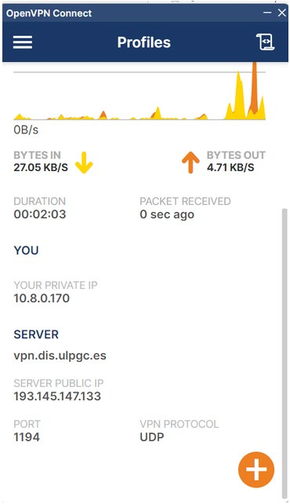
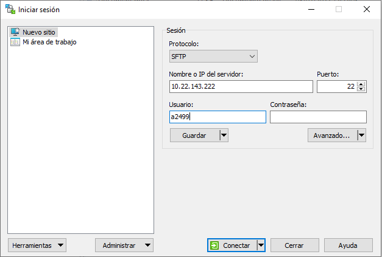
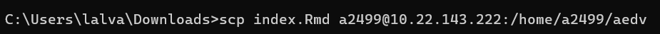
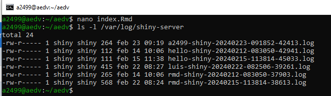
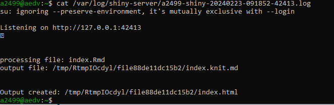

<style>
h1.title { font-size: 26px; }
h1 { font-size: 20px; }
h2 { font-size: 18px; }
h3 { font-size: 16px; }
body { font-size: 14px; }
p { font-size: 14px; margin-bottom: 10px; }
/* Botón para mostrar u ocultar el índice de la izquierda */
#boton-indice {
  position: fixed; top: 10px; right: 12px; z-index: 1000;
  padding: 2px 8px; font-size: 16px; line-height: 1.4; cursor: pointer;
  background: #fff; border: 1px solid #ccc; border-radius: 4px;
}
#boton-indice:hover { background: #f2f2f2; }
/* Con el índice oculto, el texto ocupa todo el ancho (solo en pantallas anchas) */
@media (min-width: 768px) {
  body.sin-indice .main-container > .row > div:first-child { display: none; }
  body.sin-indice .toc-content { width: 100%; }
}
/* En el móvil el índice va arriba, no al lado: el botón sobra y el índice se ve siempre */
@media (max-width: 767px) { #boton-indice { display: none; } }
</style>

<script>
document.addEventListener("DOMContentLoaded", function () {
  var boton = document.createElement("button");
  boton.id = "boton-indice";
  function actualizar() {
    var oculto = document.body.classList.contains("sin-indice");
    boton.textContent = "☰";
    boton.title = oculto ? "Mostrar índice" : "Ocultar índice";
    boton.setAttribute("aria-label", boton.title);
  }
  boton.addEventListener("click", function () {
    document.body.classList.toggle("sin-indice");
    actualizar();
    try { localStorage.setItem("servidor-shiny-sin-indice", document.body.classList.contains("sin-indice") ? "1" : "0"); } catch (e) {}
  });
  // Índice oculto por defecto, salvo que el lector lo haya dejado visible
  var visible = false;
  try { visible = localStorage.getItem("servidor-shiny-sin-indice") === "0"; } catch (e) {}
  if (!visible) document.body.classList.add("sin-indice");
  actualizar();
  document.body.appendChild(boton);
});
</script>

El cuadro de mandos del proyecto se entrega **desplegado en el servidor Shiny del DIS** (Departamento de Informática y Sistemas de la ULPGC). Este documento explica cómo subirlo, cómo abrirlo en el navegador y qué hacer si falla.

Para **subir ficheros** y **consultar los errores** hay dos formas de trabajar, y basta con elegir una:

| | Opción A: aplicación gráfica | Opción B: consola con `scp` y `ssh` |
|---|---|---|
| Windows | **WinSCP** | `cmd` o PowerShell (traen `scp` y `ssh`) |
| macOS | **Cyberduck** o **FileZilla** | Terminal (trae `scp` y `ssh`) |
| Ventajas | Se arrastran los ficheros con el ratón; recomendable si no has usado nunca la consola | No hay que instalar nada; es la única forma de cambiar la contraseña |

En todo el documento la cuenta de ejemplo es **`a2499`**: sustitúyela por la tuya, **en minúsculas** (el servidor es Linux y distingue mayúsculas de minúsculas también en el nombre de usuario).

# Antes de empezar: el cuadro de mandos tiene que funcionar en tu ordenador

No intentes desplegar un cuadro de mandos que no hayas probado antes en RStudio (*Run Document*). En el servidor los errores son más difíciles de ver, así que conviene llegar con todo funcionando. Además, para que lo que funciona en tu ordenador funcione también en el servidor:

- **Lee los ficheros de datos sin rutas**: `readRDS("misdatos.rds")`, nunca `readRDS("C:/Users/.../misdatos.rds")`. El `.Rmd` y sus datos irán juntos en la misma carpeta del servidor.
- **Respeta mayúsculas y minúsculas** en los nombres de fichero. En Windows y macOS `Datos.rds` y `datos.rds` son el mismo fichero; en el servidor, no. Evita también los espacios y las tildes en los nombres.
- **Si una función da un error de «no se pudo encontrar la función»** en el servidor, llámala indicando su librería: `libreria::funcion()` (por ejemplo, `dplyr::select()`).
- **Los datos que se leen de internet** (por ejemplo, desde `https://ctim.es/AEDV/data/...`) no hay que subirlos; los que el cuadro de mandos lee de su carpeta, sí.

# Paso 1 — Conéctate a la red del DIS

El servidor solo es accesible **desde la red interna del DIS**. Desde casa (o desde cualquier otra red) hay que conectarse antes a la **VPN del DIS**:

1. Entra en **MiDIS** (`https://www.dis.ulpgc.es/midis/`) con tus claves del Campus Virtual. Ahí encontrarás:
    - el fichero de configuración de la VPN (extensión `.ovpn`);
    - el **usuario** y la **contraseña** de tu cuenta en el servidor Shiny (*Si no te aparece el usuario y contraseña consultar con el profesor*).
2. Instala un cliente OpenVPN siguiendo las instrucciones de `https://www.dis.ulpgc.es/vpn/` (por ejemplo, *OpenVPN Connect*, que existe para Windows y para macOS) e importa en él el fichero `.ovpn`.
3. Conéctate. El cliente debe indicar que la conexión está activa, como en esta captura de OpenVPN Connect:

    {width=260px}

<div class="nota">
<strong class="bloque-titulo">Desconéctate de la VPN al terminar</strong>

Mientras la VPN está conectada, **todo tu tráfico de internet pasa por el DIS**. Desconéctala cuando acabes de trabajar con el servidor.
</div>

# Datos de tu cuenta en el servidor

| Qué | Valor (con la cuenta de ejemplo `a2499`) |
|---|---|
| Servidor | `10.22.143.222` |
| Usuario y contraseña | los de MiDIS |
| Carpeta donde se suben los ficheros | `/home/a2499/aedv` |
| Dirección del cuadro de mandos en el navegador | `http://10.22.143.222:3838/sample-apps/a2499/NombreDelFichero.Rmd` |
| Carpeta de los ficheros de errores (*logs*) | `/var/log/shiny-server/` |

Fíjate en que **lo que subes a `/home/a2499/aedv` se ve en el navegador bajo `sample-apps/a2499/`**: la carpeta `aedv` no aparece en la dirección web.

# Paso 2 — Sube el `.Rmd` y sus ficheros de datos

Sube a la carpeta `aedv` de tu cuenta el `.Rmd` del cuadro de mandos **y todos los ficheros de datos que lee** (con los mismos nombres que usa el código). Si vuelves a subir un fichero con el mismo nombre, sustituye al anterior.

## Opción A: con WinSCP (Windows) o Cyberduck / FileZilla (macOS)

1. Instala la aplicación: **WinSCP** en Windows (`https://winscp.net`); en macOS, **Cyberduck** (`https://cyberduck.io`) o **FileZilla** (`https://filezilla-project.org`, el cliente, no el servidor).
2. Con la VPN conectada, crea una conexión nueva con estos datos:

    | Campo | Valor |
    |---|---|
    | Protocolo | **SFTP** (no FTP) |
    | Servidor (*host*) | `10.22.143.222` |
    | Puerto | `22` |
    | Usuario | tu cuenta, p. ej. `a2499` |
    | Contraseña | la de MiDIS |

    En WinSCP es la ventana *Iniciar sesión* que aparece al abrir la aplicación; en Cyberduck, el botón *Abrir conexión*; en FileZilla, el *Gestor de sitios* (o la barra de conexión rápida, escribiendo `sftp://10.22.143.222` como servidor).
    Así queda la ventana *Iniciar sesión* de WinSCP con la cuenta de ejemplo:

    {width=520px}

3. Conéctate. La primera vez la aplicación pregunta si te fías de la clave del servidor: acepta.
4. Entra en la carpeta `aedv` y **arrastra** a ella el `.Rmd` y sus ficheros de datos.

## Opción B: con `scp` desde la consola (Windows y macOS)

Los comandos son **los mismos** en Windows y en macOS:

- **Windows**: abre `cmd` o PowerShell en la carpeta del cuadro de mandos. Lo más cómodo es abrir esa carpeta en el Explorador de archivos, escribir `cmd` en la barra de direcciones y pulsar Intro. También puedes abrir `cmd` y moverte con `cd`, por ejemplo `cd C:\Users\TuUsuario\Desktop\AEDV`.
- **macOS**: abre la aplicación *Terminal* y muévete a la carpeta con `cd`, por ejemplo `cd ~/Desktop/AEDV` (también puedes escribir `cd ` y arrastrar la carpeta a la ventana del Terminal).

Para subir **un fichero**:

```
scp MiDashboard.Rmd a2499@10.22.143.222:/home/a2499/aedv/
```

Así se ve en la consola de Windows, subiendo un fichero `index.Rmd` desde la carpeta `Downloads`:

{width=640px}

Para subir **varios** a la vez, escríbelos uno detrás de otro:

```
scp MiDashboard.Rmd misdatos.rds a2499@10.22.143.222:/home/a2499/aedv/
```

Cada vez te pedirá la contraseña (al escribirla no se ve nada en la pantalla: es normal). La primera vez preguntará además si te fías del servidor (`Are you sure you want to continue connecting`): responde `yes`.

<div class="nota">
<strong class="bloque-titulo">Cuidado con `scp *`</strong>

`scp * a2499@10.22.143.222:/home/a2499/aedv/` sube **todo** lo que haya en la carpeta, incluida la memoria, los `.html` y cualquier fichero grande que no necesite el cuadro de mandos, y **no sube las subcarpetas** (para eso haría falta `scp -r`). Es mejor indicar los ficheros uno a uno.
</div>

# Paso 3 — Abre el cuadro de mandos en el navegador

Con la VPN conectada, escribe en el navegador:

```
http://10.22.143.222:3838/sample-apps/a2499/MiDashboard.Rmd
```

sustituyendo `a2499` por tu cuenta y `MiDashboard.Rmd` por el nombre **exacto** de tu fichero (con sus mayúsculas). La primera carga tarda unos segundos, porque el servidor tiene que compilar el `.Rmd`. Esa es la dirección que va en el enlace al inicio de tu memoria.

<div class="metodo">
<strong class="bloque-titulo">Primera prueba: un cuadro de mandos de ejemplo</strong>

Antes de subir el tuyo, comprueba que la conexión y la cuenta funcionan con un ejemplo que ya está preparado para el servidor (lee los datos de internet, así que no hay que subir nada más):

1. Descarga `https://ctim.es/AEDV/Dashboard_mapa_coropletico.Rmd`.
2. Súbelo a tu carpeta `aedv` (Paso 2).
3. Ábrelo en `http://10.22.143.222:3838/sample-apps/a2499/Dashboard_mapa_coropletico.Rmd`.

Los cuadros de mandos de ejemplo de `https://ctim.es/AEDV/` sirven también para ver qué adaptaciones necesita el código para funcionar en el servidor.
</div>

# Paso 4 — Si no funciona: consulta el fichero de errores

Cuando el cuadro de mandos funciona en tu ordenador pero en el servidor falla (página en gris, mensaje de error o *An error has occurred*), el motivo queda escrito en un **fichero de *log*** en la carpeta `/var/log/shiny-server/` del servidor. Cada vez que se abre un cuadro de mandos se crea uno nuevo, con un nombre de la forma:

```
a2499-shiny-AAAAMMDD-HHMMSS-NNNNN.log
```

(tu cuenta, la fecha y la hora en que se abrió, y un número). En esa carpeta están los ficheros de todas las cuentas: busca los que empiezan por tu cuenta y mira **el más reciente**. Normalmente las últimas líneas dicen qué ha fallado: un fichero que no encuentra, una librería o una función que no existe, etc.

## Opción A: con WinSCP, Cyberduck o FileZilla

En la misma conexión del Paso 2, ve a la carpeta `/var/log/shiny-server/` (en WinSCP, escribiendo la ruta en la barra de dirección de la parte del servidor, o con *Ctrl+O*; en Cyberduck, con *Ir → Ir a la carpeta*; en FileZilla, escribiéndola en *Sitio remoto*). Ordena los ficheros por fecha y abre o descarga el último de tu cuenta.

## Opción B: con `ssh` desde la consola

Conéctate al servidor (los mismos comandos en Windows y en macOS):

```
ssh a2499@10.22.143.222
```

A partir de aquí estás trabajando **dentro del servidor** (Linux). Para listar tus ficheros de errores, del más reciente al más antiguo:

```
ls -t /var/log/shiny-server/a2499-*
```

y para ver uno (copia su nombre de la lista anterior):

```
cat /var/log/shiny-server/a2499-shiny-20261015-101530-42413.log
```

Por ejemplo, la cuenta `a2499` lista los *logs* (verás también los de otras cuentas si no filtras por la tuya)…

{width=640px}

…y abre el suyo. Este cuadro de mandos (`index.Rmd`) se ha compilado sin errores (`Output created`); cuando algo falla, el mensaje de error aparece en estas mismas líneas:

{width=640px}

Para salir del servidor y volver a tu ordenador, escribe `exit`.

# Cambiar la contraseña

Es recomendable cambiar la contraseña la primera vez que entres. Se hace por `ssh` (Opción B, también si para subir ficheros usas WinSCP o Cyberduck):

```
ssh a2499@10.22.143.222
passwd
```

`passwd` pide primero la contraseña actual y después dos veces la nueva. A partir de ese momento la de MiDIS deja de valer para el servidor Shiny: guarda la nueva.

# Problemas frecuentes

| Síntoma | Causa probable |
|---|---|
| El navegador no llega a cargar la página, o WinSCP / `scp` / `ssh` no conectan | La VPN no está conectada |
| *Not Found* en el navegador | El nombre de la cuenta o del fichero de la dirección no coincide exactamente (mayúsculas incluidas), o el fichero no está en la carpeta `aedv` |
| *Permission denied* al conectar | Usuario o contraseña incorrectos (el usuario, en minúsculas) |
| Funciona en tu ordenador y en el servidor da error | Falta subir algún fichero de datos, se lee con una ruta, o no coinciden las mayúsculas de su nombre: mira el *log* (Paso 4) |
| *no se pudo encontrar la función* / *could not find function* | Indica la librería: `libreria::funcion()` |
| Has subido una versión nueva y se sigue viendo la anterior | Recarga la página (F5) y comprueba que has subido el fichero a la carpeta `aedv` y con el mismo nombre |
